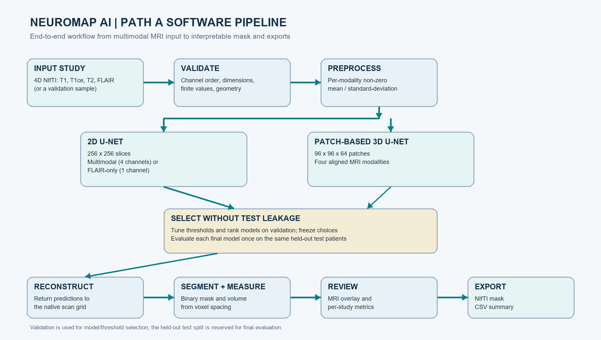
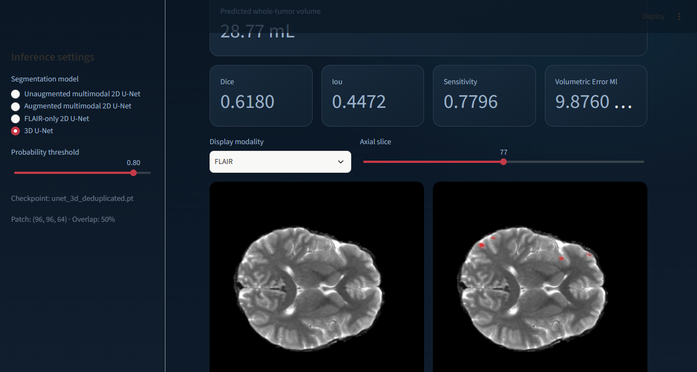

# NeuroMap AI: Multimodal Brain MRI Segmentation and Volumetric Analysis

**Final project report**  
Prepared November 25, 2026  
Course: AI2002 Artificial Intelligence, Semester Project - Fall 2026  
Selected path: **Path A - Software-Based**  
Project stage: Stage A research prototype  
Final submission deadline: December 6, 2026  
Group number: **[Complete before submission]**  
Group members: **Fizza Fatima (24i-3077); Irtaza Abid (24i-3085)**

> **Safety statement:** NeuroMap is a research prototype. It is not a medical
> device and must not be used for diagnosis, treatment decisions, or
> independent clinical measurement.

## Abstract

This project developed NeuroMap, a research system for binary whole-tumor
segmentation from multimodal brain MRI and volumetric measurement. The work
uses the labeled Medical Segmentation Decathlon Task01_BrainTumour cohort.
After auditing patient overlap, six duplicate-label cases were removed before
forming a deterministic patient-level split of 334 training, 72 validation,
and 72 held-out test cases. Four 50-epoch experiments were completed:
unaugmented four-modality 2D U-Net, augmented four-modality 2D U-Net,
FLAIR-only 2D U-Net, and patch-based four-modality 3D U-Net.

Thresholds and the final model were selected using validation patients only.
The augmented multimodal 2D model ranked first by validation Dice
(0.88615 at threshold 0.75). It achieved test Dice 0.84895, IoU 0.75002,
sensitivity 0.83788, and mean absolute volume error 11.67610 mL on the
72-patient held-out test split. Each model was evaluated once on that split.
A Streamlit application supports MRI input, inference, overlays, measurements,
and NIfTI/CSV exports. Tests and local browser smoke checks passed. Results
are limited to one public dataset and one internal held-out split; no external
or clinical validation was performed.

## 1. Problem and objectives

Glioma-related regions can be difficult to review consistently across several
MRI contrasts. NeuroMap explores a reproducible segmentation workflow that
accepts T1, contrast-enhanced T1 (T1ce), T2, and FLAIR input, predicts a binary
whole-tumor mask, visualizes that mask on MRI slices, and estimates physical
volume from image voxel spacing.

The intended users are researchers and technical reviewers examining
segmentation outputs from brain MRI studies. They need a reproducible way to
inspect a whole-tumor mask and its physical volume across a scan. NeuroMap
supports that research workflow; it is not intended to guide clinical
diagnosis or treatment decisions.

The primary research questions were:

1. How does four-modality segmentation compare with a FLAIR-only model under
   the same patient-level evaluation protocol?
2. How does patch-based 3D segmentation compare with slice-based 2D
   segmentation on the same split?

The scope is limited to binary whole-tumor segmentation. Multi-region labels,
post-treatment longitudinal analysis, external-cohort validation, and
clinical deployment are outside this release.

## 2. Dataset and split integrity

The source is the labeled Medical Segmentation Decathlon Task01_BrainTumour
dataset, distributed as NIfTI volumes with four MRI modalities and expert
labels [1]. The labeled cohort contains 484 cases. An audit found six
duplicate-label cases; these were removed before the final split. The retained
478 cases were assigned at patient level with seed 42:

| Partition | Patients | Approximate share |
|---|---:|---:|
| Train | 334 | 69.9% |
| Validation | 72 | 15.1% |
| Test | 72 | 15.1% |

All slices from a patient remained within one partition. Validation data was
used for threshold tuning and model ranking. The held-out test set was not
used to select the model or thresholds. Each final model was evaluated once
on the same 72 test patients. The challenge's separate unlabeled test images
were not treated as ground-truth evaluation data.

The split manifest is intentionally excluded from Git because it contains
machine-specific absolute paths. `submission/artifact_access.md` gives the
command to regenerate the deduplicated split and the expected counts.

## 3. System architecture and methods

### 3.1 Architecture and end-to-end pipeline

The project follows **Path A - Software-Based**: its core result is generated
by trained neural networks and is presented through a Streamlit application.
The application accepts a four-modality NIfTI study or a preloaded validation
sample, validates its data, performs actual model inference, and returns a
segmentation, visualization, measurement, and exports.

The 2D and 3D U-Nets are appropriate for this task because they predict a
spatial mask rather than one class for an entire scan. Their encoder-decoder
structure and skip connections preserve spatial detail; the multimodal models
receive aligned MRI contrasts as input channels, while the FLAIR-only model
provides a single-modality comparison. The 3D model additionally uses
neighboring-slice context.

### 3.2 Input validation and preprocessing

NIfTI volumes are loaded with NiBabel. The pipeline validates the four-channel
layout, finite values, image/label dimensions, and spatial alignment. Each MRI
modality is normalized independently using its non-zero voxels; non-finite
values are handled explicitly. Non-background labels are converted to a
binary mask. The 2D pipeline uses 256 x 256 in-plane inputs and restores
predictions to the native grid for volume-level evaluation. Physical volume
uses the NIfTI voxel spacing and is reported in milliliters.

### 3.3 Models and training

The 2D models use a MONAI U-Net with four feature levels
(16, 32, 64, 128), three downsampling strides, and two residual units. The
FLAIR-only experiment uses the same architecture with a single input channel.
The 3D model uses a four-channel MONAI U-Net with feature levels
(16, 32, 64, 128) and one residual unit.

| Experiment | Inputs | Training design |
|---|---|---|
| Unaugmented multimodal 2D | T1, T1ce, T2, FLAIR | 50 epochs, 256 x 256 slices |
| Augmented multimodal 2D | T1, T1ce, T2, FLAIR | 50 epochs; paired random in-plane image/mask flips |
| FLAIR-only 2D | FLAIR | 50 epochs, same patient split |
| Patch-based multimodal 3D | T1, T1ce, T2, FLAIR | 50 epochs; 96 x 96 x 64 patches, two patches per case per epoch |

The 2D training loss combines binary cross-entropy with soft Dice loss; the
optimizer is AdamW. The 3D pipeline uses batch size one. Validation and test
data are not augmented. Full-volume 3D inference uses overlapping
Gaussian-weighted sliding windows with 50% overlap.

### 3.4 Threshold and model selection

Candidate thresholds were evaluated on validation patients. Each model used
its own validation-selected threshold. The comparison selected the candidate
with the highest mean patient Dice, breaking ties by lower mean absolute
volume error. This rule selected augmented multimodal 2D before the test
results were inspected. Test metrics are descriptive only and did not affect
selection.

## 4. Evaluation

Metrics are patient-level volume scores aggregated as macro means:

- **Dice:** overlap between prediction and reference.
- **IoU:** intersection divided by union.
- **Sensitivity:** fraction of reference tumor voxels recovered.
- **Absolute volume error:** absolute predicted/reference volume difference
  in mL.

### 4.1 Validation results used for selection

| Model | Threshold | Dice | IoU | Sensitivity | Absolute volume error (mL) |
|---|---:|---:|---:|---:|---:|
| Augmented multimodal 2D | 0.75 | 0.88615 | 0.80034 | 0.89119 | 9.79871 |
| Patch-based multimodal 3D | 0.80 | 0.87621 | 0.78998 | 0.88760 | 12.27921 |
| Unaugmented multimodal 2D | 0.65 | 0.87086 | 0.77660 | 0.87375 | 9.51357 |
| FLAIR-only 2D | 0.75 | 0.83246 | 0.72136 | 0.84140 | 12.37064 |

The augmented multimodal model was selected by validation Dice. The
unaugmented model had a slightly lower validation volume error, illustrating
that the selected model reflects the declared ranking rule rather than a
single metric chosen after inspecting the test set.

### 4.2 Held-out test results

Each row is one evaluation on the same 72-patient held-out test set, using
the threshold selected on validation.

| Model | Threshold | Dice | IoU | Sensitivity | Absolute volume error (mL) |
|---|---:|---:|---:|---:|---:|
| Augmented multimodal 2D (selected) | 0.75 | 0.84895 | 0.75002 | 0.83788 | 11.67610 |
| Unaugmented multimodal 2D | 0.65 | 0.83444 | 0.72762 | 0.81923 | 11.30874 |
| FLAIR-only 2D | 0.75 | 0.78574 | 0.66519 | 0.79234 | 12.77144 |
| Patch-based multimodal 3D | 0.80 | 0.83741 | 0.73782 | 0.86814 | 11.50800 |

Augmented multimodal 2D had the highest test Dice in this comparison, while
3D had the highest test sensitivity. The baseline had the lowest mean
absolute volume error among the four test runs. These are descriptive
comparisons on one split; no confidence intervals, statistical significance
tests, or external validation are claimed.

## 5. Application and verification

The application provides an input-to-result workflow: upload or select a
study, choose a trained model, run inference, review the overlay and
measurements, and export the mask and summary. The held-out test patients are
not available as preloaded demo samples.

The Streamlit research interface supports:

- Four-modality NIfTI upload with channel-order confirmation and input checks.
- Preloaded validation studies, keeping the held-out test set reserved.
- Selection of unaugmented 2D, augmented 2D, FLAIR-only 2D, or 3D inference.
- Modality and axial-slice navigation, prediction/reference overlays, and
  physical-volume measurements.
- NIfTI segmentation-mask and CSV measurement-summary exports.

The application was smoke-tested locally on a validation case using augmented
2D and 3D inference. Both produced overlays and measurements on CUDA. The
Streamlit health endpoint returned HTTP 200. Both export files were downloaded
to the local Downloads folder and checked: the mask is a binary NIfTI volume
with shape 240 x 240 x 155 and 1 mm voxel spacing; the CSV contains the patient
identifier, threshold, spacing, predicted/reference volumes, and evaluation
metrics. The 40-test suite includes representative 2D and 3D inference,
checkpoint and split handling, corrupt NIfTI input, wrong channel count,
reference-geometry mismatch, metric edge cases, and NIfTI export geometry.

The image below is one qualitative **validation** example from BRATS_029 using
the 3D model at threshold 0.80. It is an individual validation case, not an
aggregate test result. In the overlay, yellow indicates agreement, red a false
positive, and cyan a false negative.

For this example, the interface reported Dice 0.6180, IoU 0.4472, sensitivity
0.7796, and absolute volume error 9.8760 mL. These per-case values must not be
confused with the model-level held-out test means in Section 4.

## 6. Discussion

On this split, multimodal inputs outperformed FLAIR-only input in Dice, in
both validation and test results. The 3D result was close to the unaugmented
2D baseline in test Dice and produced higher test sensitivity, but did not
exceed the selected augmented 2D model's test Dice. These observations answer
the two primary research questions for this experiment, not for other
institutions or acquisition protocols.

The label-duplicate audit was important: the original split had duplicated
cases crossing partition boundaries, which could bias model selection and
evaluation. The final experiments were trained and assessed after those
duplicates were removed. The original, contaminated evaluation is retained
only as a provisional diagnostic in `reports/error_analysis.md` and is not
used for the final model comparison.

## 7. Limitations, ethics, and risk

1. **Single source and split.** The evaluation uses one public dataset and one
   held-out split from its labeled cohort. There is no independent external,
   prospective, or clinical validation.
2. **Research target.** The system produces a binary whole-tumor mask; it does
   not separate tumor subregions or determine diagnosis, progression, or
   treatment response.
3. **Measurement interpretation.** Volume depends on image geometry and
   segmentation quality. It is a calculated mask volume, not an independent
   tumor-burden determination.
4. **No uncertainty estimates.** The reported point metrics do not describe
   all sources of model or annotation uncertainty.
5. **Deployment.** The app is a local demonstration; public hosting,
   security review, workflow validation, and clinical governance have not been
   completed.
6. **Deployment and submission.** The local Streamlit app is functional and
   smoke-tested, but it has not been deployed to Streamlit Community Cloud.
   The project statement makes Streamlit deployment mandatory for Path A.
   The group must also submit one ZIP containing the required deliverables on
   GCR; preparing this package does not itself constitute submission.

## 8. Reproducibility and handoff

The repository contains training, inference, evaluation, threshold-selection,
and test code. The local validated environment used Python 3.11,
PyTorch 2.11.0+cu128, MONAI 1.6.1, and Streamlit 1.67.0. The source and
test suite are available in the merged GitHub repository. Dataset files,
checkpoints, split manifests, and generated patient-level JSON reports are
excluded from source control.

The four final checkpoints and their matching histories, configs, and
validation reports are assembled locally in
`artifacts/submission_models_2026-11-25.zip`. Share that archive with the
evaluator through approved storage. The dataset must be downloaded from the
official MSD source; regenerate the split on the receiving computer using the
command in `artifact_access.md`, because the training manifest contains
machine-specific absolute paths.

The preloaded study workflow is suitable for a local demonstration when the
dataset, checkpoints, and local validation reports are restored. Streamlit
Community Cloud deployment and GCR submission remain outstanding.

## 9. Conclusion

NeuroMap implements and evaluates multimodal 2D, augmented 2D, FLAIR-only
2D, and patch-based 3D whole-tumor segmentation on a corrected,
patient-separated split. Validation-only selection chose the augmented
multimodal 2D model; its test Dice was 0.84895 on 72 held-out patients. The
application provides an end-to-end local research workflow for study
selection, segmentation review, measurement, and export. Core model and
evaluation work is complete, but final Path A compliance is not yet complete:
Streamlit Community Cloud deployment, group identification, and the required
GCR ZIP submission remain outstanding.

## References

1. Antonelli, M. et al. "The Medical Segmentation Decathlon." *Nature
   Communications* 13, Article 4128 (2022).
   <https://doi.org/10.1038/s41467-022-30695-9>
2. Ronneberger, O., Fischer, P., and Brox, T. "U-Net: Convolutional Networks
   for Biomedical Image Segmentation." MICCAI 2015, LNCS 9351, pp. 234-241.
   <https://doi.org/10.1007/978-3-319-24574-4_28>
3. MONAI documentation. <https://monai.readthedocs.io/>
4. PyTorch documentation. <https://pytorch.org/docs/>
5. NiBabel documentation. <https://nipy.org/nibabel/>
6. Streamlit documentation. <https://docs.streamlit.io/>
7. Medical Segmentation Decathlon AWS Open Data registry.
   <https://registry.opendata.aws/msd/>
